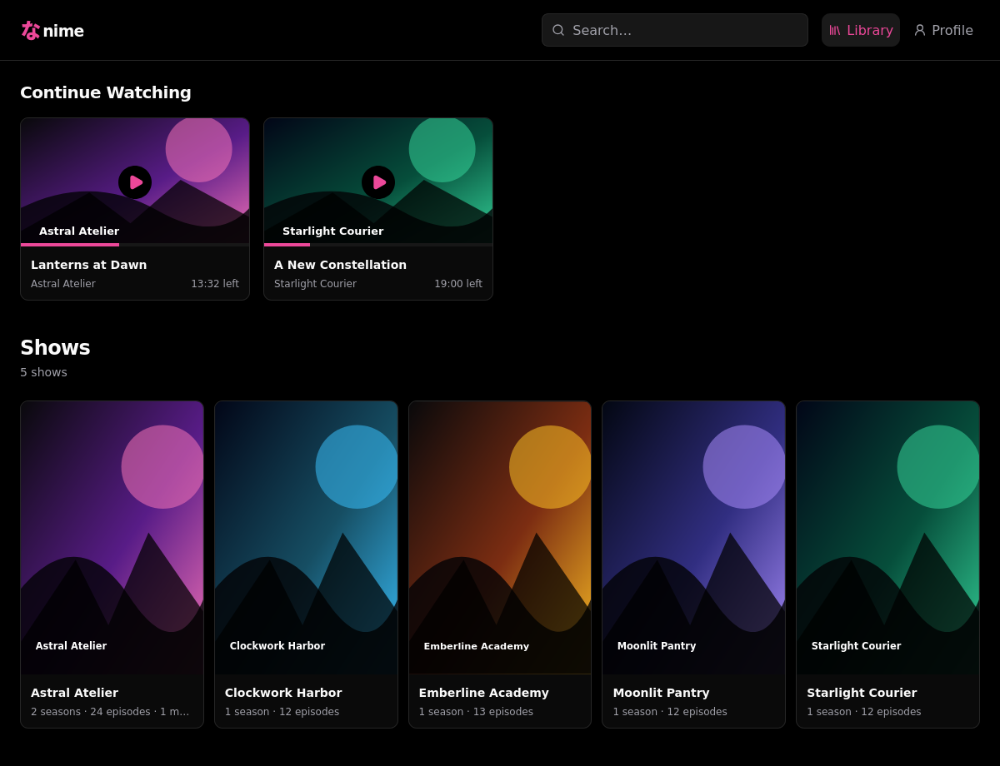

# Nanime

Nanime is a self-hosted anime library and streaming PWA. It scans local media,
tracks playback, serves subtitles and audio tracks, and uses ffmpeg when a file
needs HLS playback or transcoding. Metadata comes from Jikan, AniList, and
TVmaze. AniList account sync and qBittorrent download management are optional.



## Requirements

- [Bun](https://bun.sh/) 1.3+
- `ffmpeg` and `ffprobe` on `PATH`
- A media directory

## Run

```sh
bun install
cp .env.example .env
bun run build
bun run start
```

Edit `.env` before starting. At minimum, set `MEDIA_DIR`, `NANIME_DATABASE`, and
a random `NANIME_ADMIN_SETUP_TOKEN` of at least 32 characters. Bun loads `.env`
automatically.

Open the configured origin, activate `admin` with the setup token and a password
of at least 15 characters, then remove the setup token from `.env`. Create other
users from the admin panel.

## Develop

For local HTTP development, set:

```dotenv
NANIME_PUBLIC_ORIGIN=http://localhost:5173
NANIME_SECURE_COOKIES=false
NANIME_TRUST_PROXY=false
```

Run `bun run start` and `bun run dev` in separate terminals. Before committing,
run `bun run check`; run `bun test` for relevant server changes.

## Deploy

Nanime binds to `127.0.0.1` by default. Put it behind a TLS reverse proxy, set
`NANIME_PUBLIC_ORIGIN` to the exact HTTPS origin, and leave secure cookies on.
Enable `NANIME_TRUST_PROXY` only when the proxy is the sole route to Nanime.

Run the service as an unprivileged user. Protect the SQLite database and
qBittorrent credentials. The media directory needs write access only for
downloads, uploads, transcoding, pruning, or deletion.

See [`.env.example`](.env.example) for configuration and
[`SECURITY.md`](SECURITY.md) for security reporting.
